# Лабораторная № 1 — Введение в функциональное программирование

**Дисциплина:** Основы функционального программирования  
**Язык:** Python · **Среда:** Visual Studio Code

[**Пошаговое руководство для новичков →**](GUIDE.md) · [Ко всем лабораторным](../README.md)

---

## О работе

Чистые функции, декларативный подход, ленивые вычисления, рекурсия и unit-тестирование.

**Цель:** освоить изученные понятия функционального программирования на практических примерах, последовательно выполнить задания и проверить результаты.

## Какие задания выполнены

1. Чистые функции, неизменяемые данные и побочные эффекты
2. Сравнение циклов с map, filter и reduce
3. Генераторы, отложенные вычисления и обработка списков
4. Обычная и хвостовая рекурсия
5. Модульные проверки с unittest

## Файлы

| Файл | Назначение |
|:---|:---|
| [`lab1.py`](lab1.py) | Чистые функции и основы функционального подхода |
| [`lab1_block2.py`](lab1_block2.py) | Императивный и декларативный стили |
| [`lab1_block3.py`](lab1_block3.py) | Ленивые вычисления и генераторы |
| [`lab1_block4.py`](lab1_block4.py) | Циклы и рекурсия |
| [`lab1_block5.py`](lab1_block5.py) | Автоматические тесты unittest |
| [`GUIDE.md`](GUIDE.md) | Самостоятельная установка, запуск, объяснения и устранение ошибок |
| `images/` | Скриншоты кода и результатов из выполненного отчёта |

## Как запустить

Установите Python 3, откройте папку `lab-01` в VS Code и выполните команды по очереди в PowerShell:

```powershell
py --version
py lab1.py
py lab1_block2.py
py lab1_block3.py
py lab1_block4.py
py lab1_block5.py
```

Если Windows не распознаёт `py`, используйте `python` после проверки `python --version`. Никаких сторонних библиотек этим программам не требуется.

> [!NOTE]
> **Проверено на предоставленных исходниках:** Все пять файлов успешно выполнены; блок 5: 14 тестов, результат OK. Время и оформление вывода могут отличаться на других системах.

## Наглядная схема

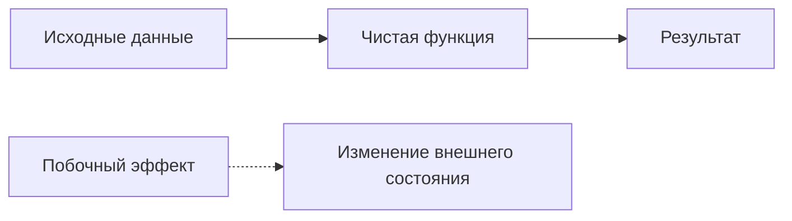

## Скриншоты кода и результатов

Изображения взяты из исходных материалов лабораторной. Для удобства чтения разделы можно раскрывать по одному.

<details>
<summary><strong>Скриншот 1: код программы</strong></summary>

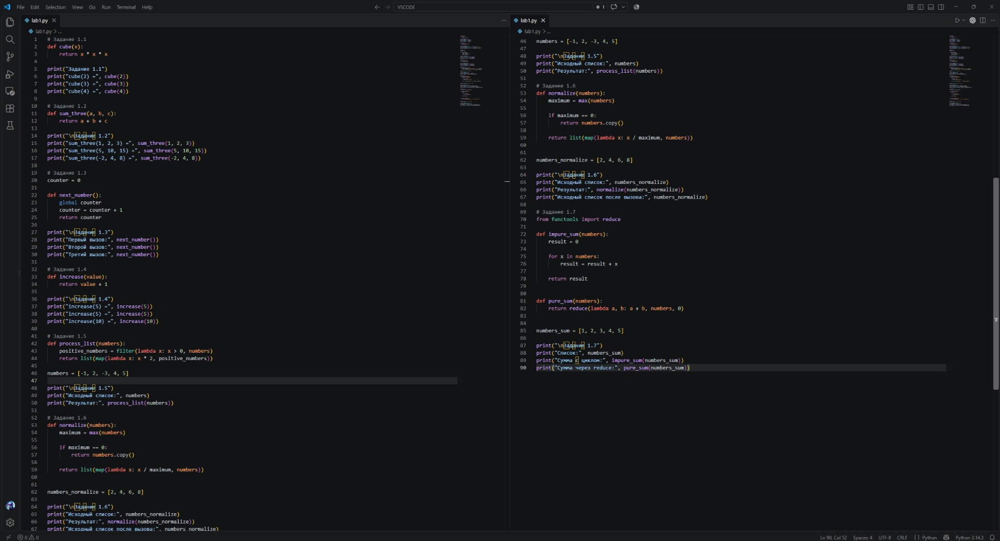

</details>

<details>
<summary><strong>Скриншот 2: результаты запуска</strong></summary>

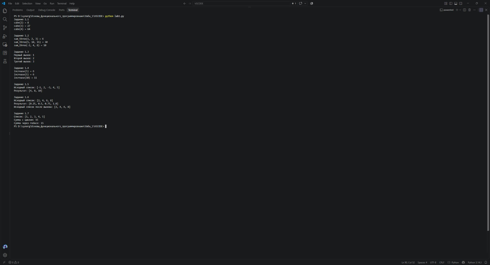

</details>

<details>
<summary><strong>Скриншот 3: код программы</strong></summary>

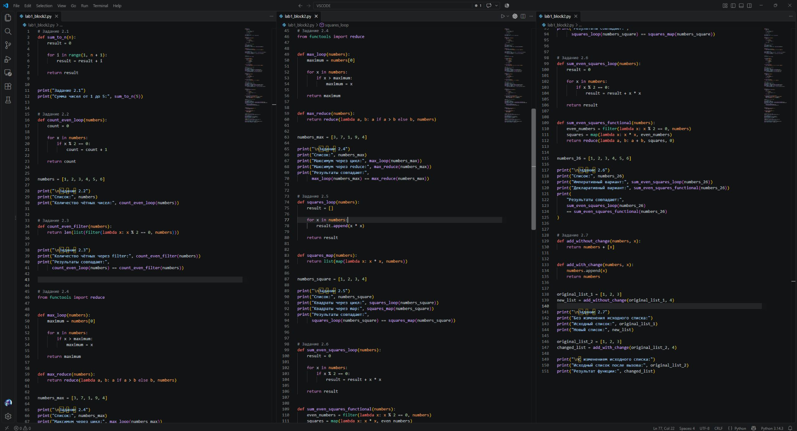

</details>

<details>
<summary><strong>Скриншот 4: результаты запуска</strong></summary>

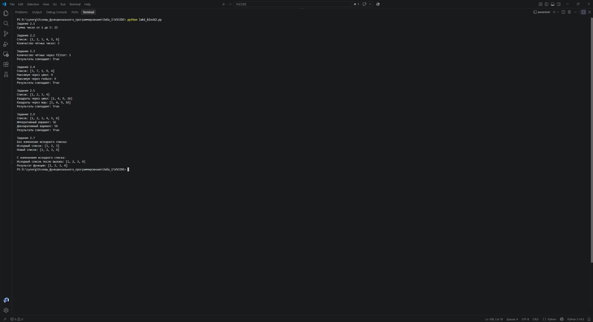

</details>

<details>
<summary><strong>Скриншот 5: код программы</strong></summary>

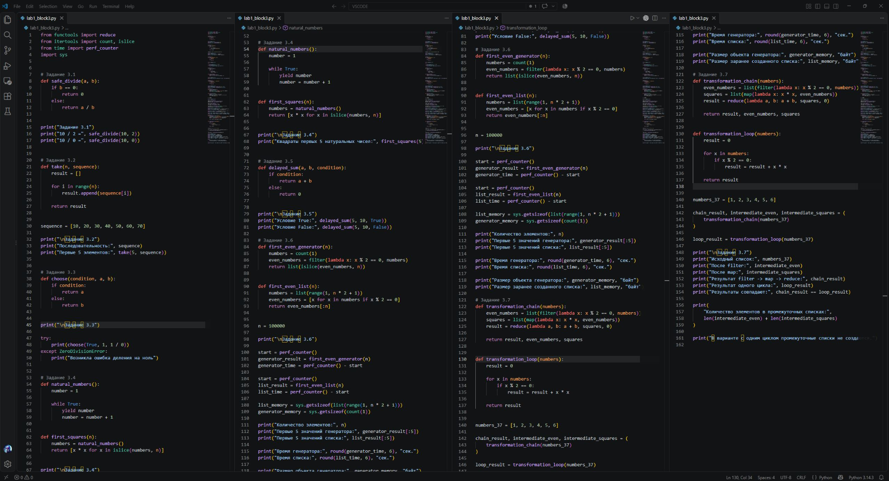

</details>

<details>
<summary><strong>Скриншот 6: результаты запуска</strong></summary>

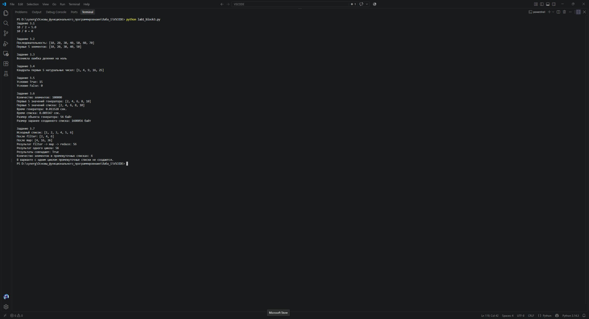

</details>

<details>
<summary><strong>Скриншот 7: код программы</strong></summary>

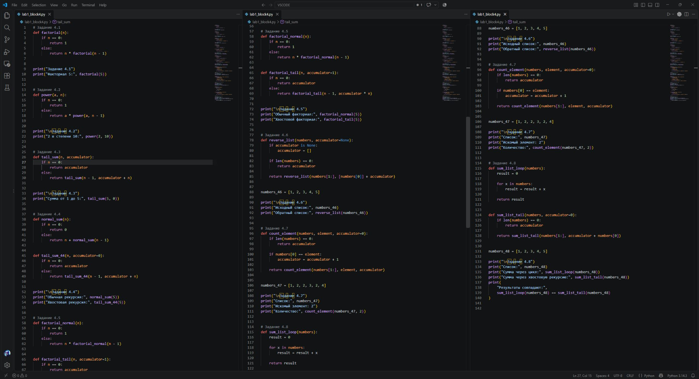

</details>

<details>
<summary><strong>Скриншот 8: результаты запуска</strong></summary>

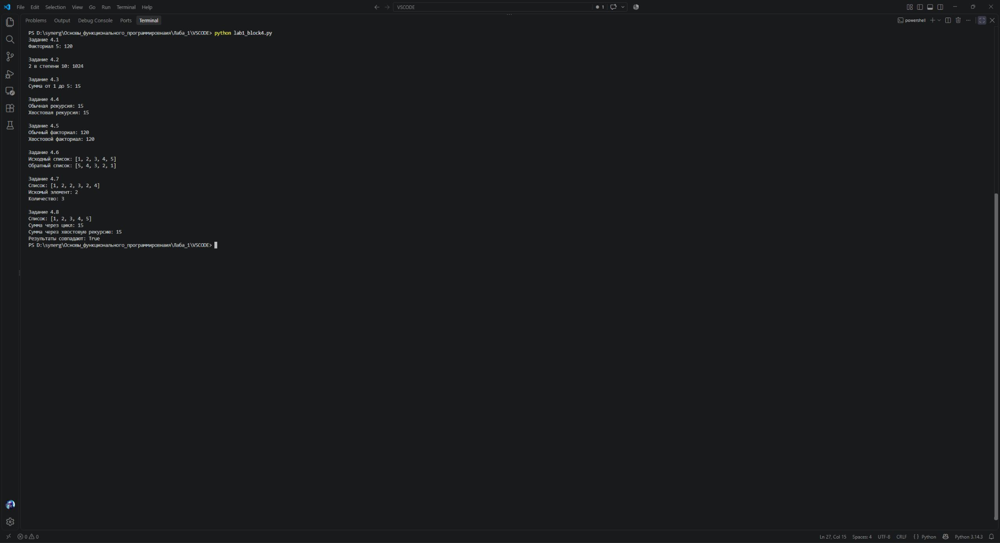

</details>

<details>
<summary><strong>Скриншот 9: код программы</strong></summary>

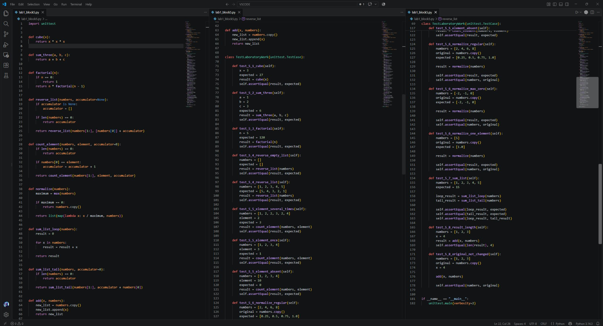

</details>

<details>
<summary><strong>Скриншот 10: результаты запуска</strong></summary>

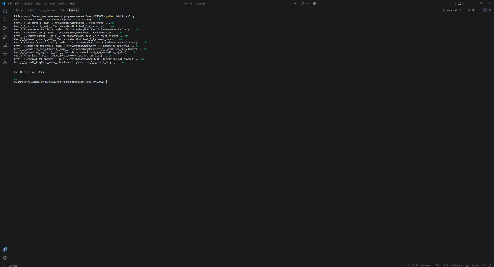

</details>

## Самостоятельное изучение

- [Полный гайд по этой лабораторной](GUIDE.md) — установка, команды, объяснение заданий, частые ошибки и тренировочные упражнения.
- [Официальный учебник Python](https://docs.python.org/3/tutorial/) — основы языка и функции.
- [Python в Visual Studio Code](https://code.visualstudio.com/docs/python/python-tutorial) — установка и запуск.

---

**Навигация:** [К началу](#лабораторная--1---введение-в-функциональное-программирование) · [Все лабораторные](../README.md)
