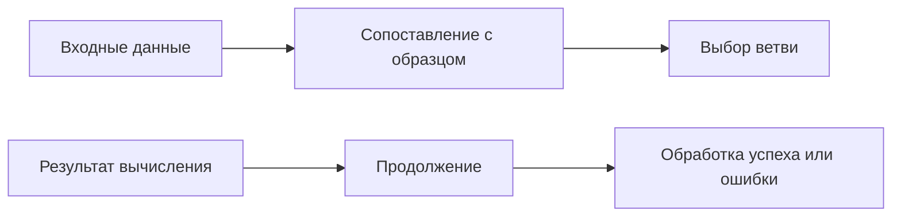
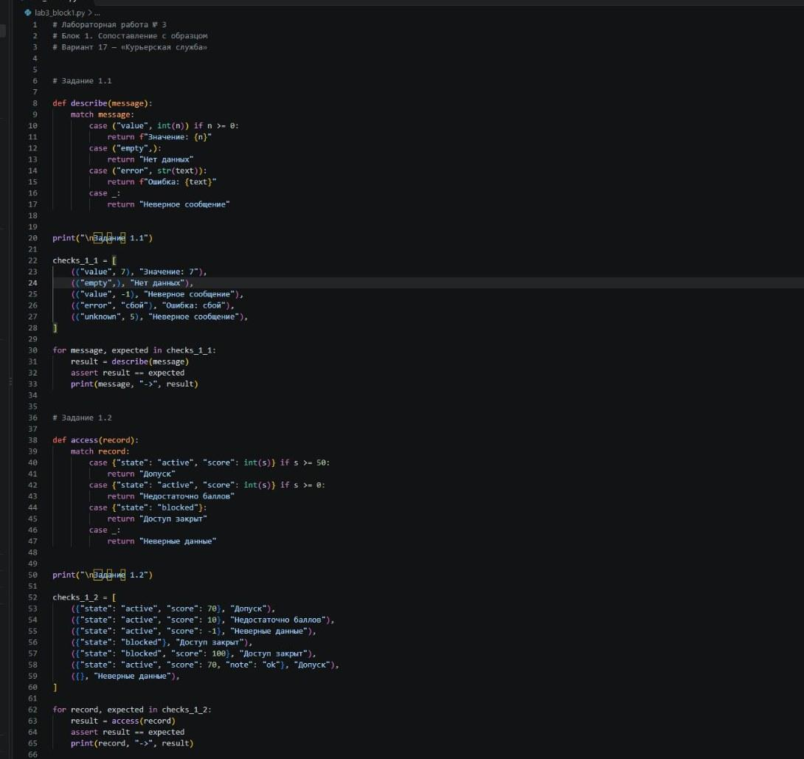
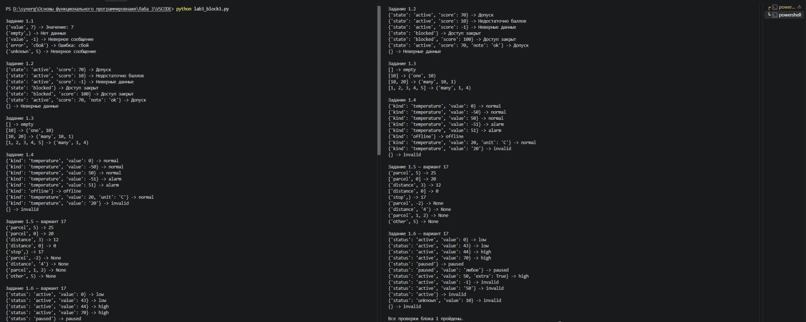
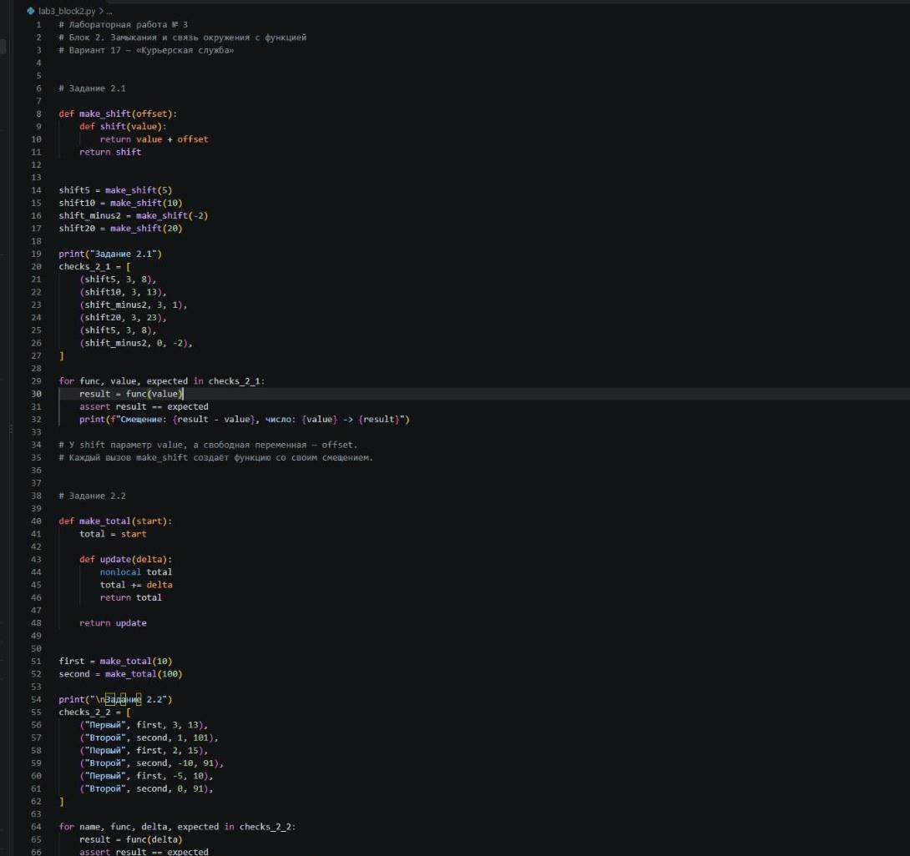
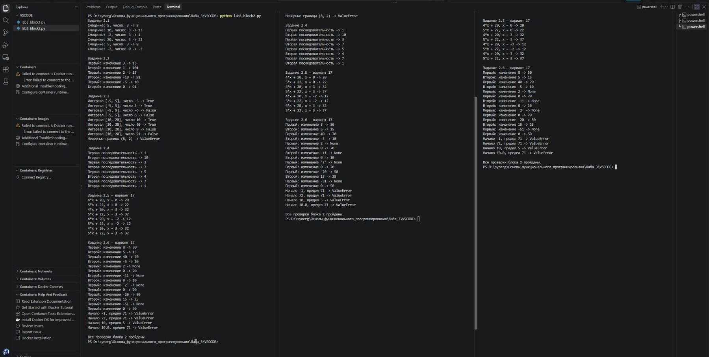
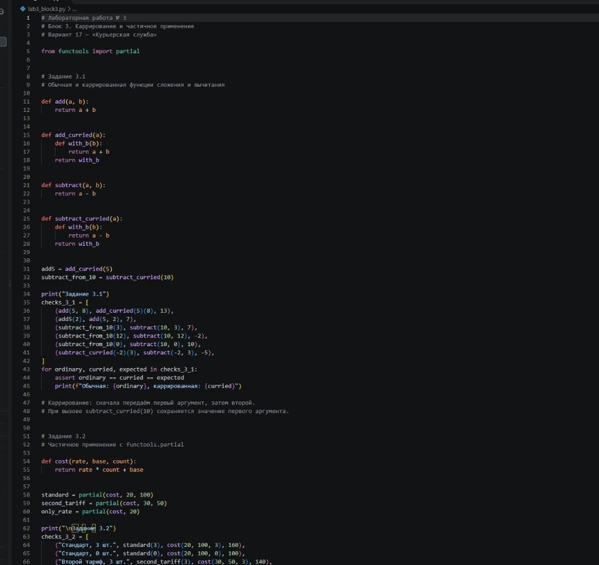
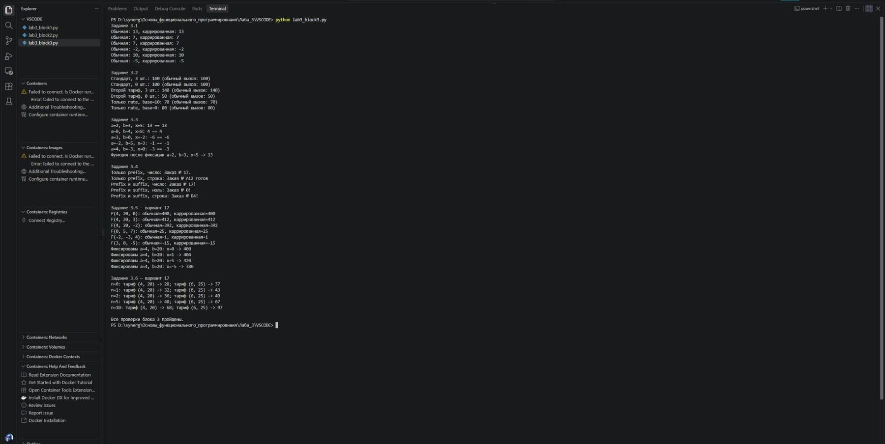
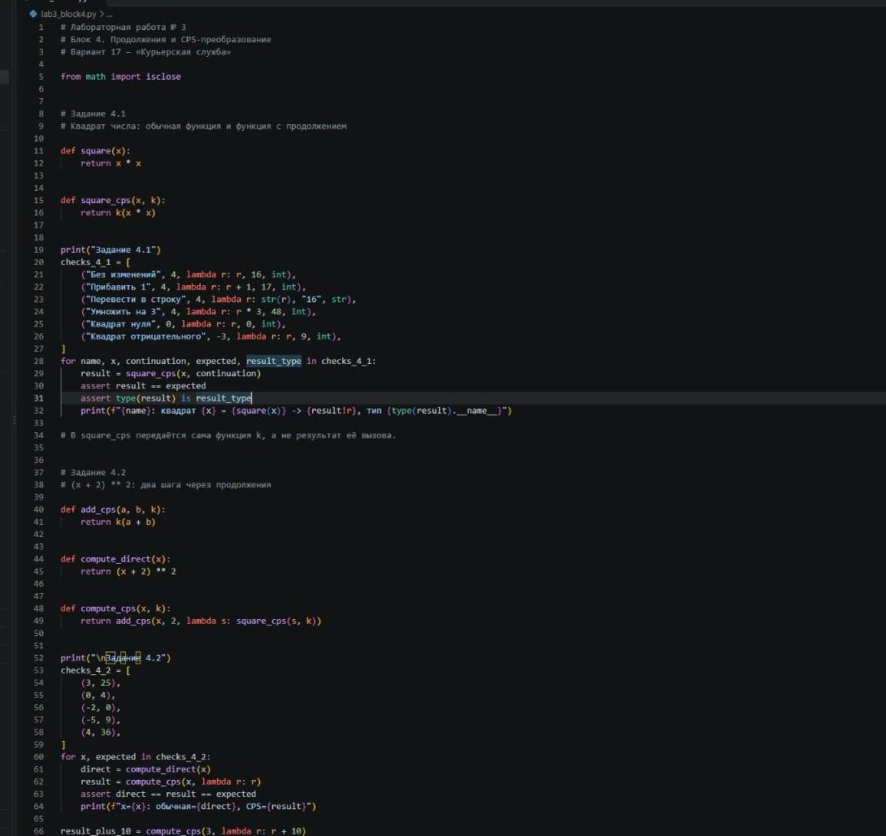
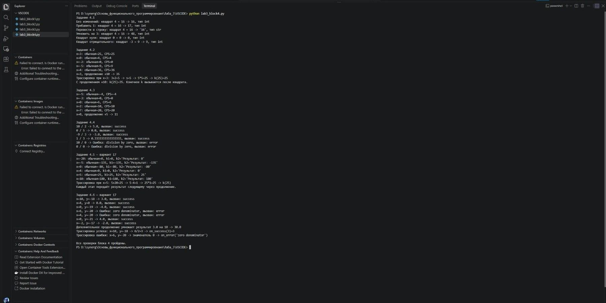

# Лабораторная № 3 — Сопоставление с образцом, замыкания, каррирование, продолжения

**Дисциплина:** Основы функционального программирования  
**Язык:** Python · **Среда:** Visual Studio Code

[**Пошаговое руководство для новичков →**](GUIDE.md) · [Ко всем лабораторным](../README.md)

---

## О работе

Python, индивидуальный вариант № 17 «Курьерская служба».

**Цель:** освоить изученные понятия функционального программирования на практических примерах, последовательно выполнить задания и проверить результаты.

## Какие задания выполнены

1. Сопоставление с образцом через match/case
2. Замыкания и функция, сохраняющая окружение
3. Каррирование и частичное применение через functools.partial
4. Продолжения (CPS) и обработка двух исходов вычисления
5. Индивидуальный вариант № 17 — «Курьерская служба»

## Файлы

| Файл | Назначение |
|:---|:---|
| [`lab3_block1.py`](lab3_block1.py) | Сопоставление с образцом (match/case) |
| [`lab3_block2.py`](lab3_block2.py) | Замыкания и состояние окружения |
| [`lab3_block3.py`](lab3_block3.py) | Каррирование и частичное применение |
| [`lab3_block4.py`](lab3_block4.py) | Продолжения и CPS-преобразование |
| [`GUIDE.md`](GUIDE.md) | Самостоятельная установка, запуск, объяснения и устранение ошибок |
| `images/` | Скриншоты кода и результатов из выполненного отчёта |

## Как запустить

Установите Python 3, откройте папку `lab-03` в VS Code и выполните команды по очереди в PowerShell:

```powershell
py --version
py lab3_block1.py
py lab3_block2.py
py lab3_block3.py
py lab3_block4.py
```

Если Windows не распознаёт `py`, используйте `python` после проверки `python --version`. Никаких сторонних библиотек этим программам не требуется.

> [!NOTE]
> **Проверено на предоставленных исходниках:** Все четыре программы выполнены успешно, каждый блок завершился сообщением о прохождении проверок. Время и оформление вывода могут отличаться на других системах.

## Наглядная схема



## Скриншоты кода и результатов

Изображения взяты из исходных материалов лабораторной. Для удобства чтения разделы можно раскрывать по одному.

<details>
<summary><strong>Скриншот 1: код программы</strong></summary>



</details>

<details>
<summary><strong>Скриншот 2: результаты запуска</strong></summary>



</details>

<details>
<summary><strong>Скриншот 3: код программы</strong></summary>



</details>

<details>
<summary><strong>Скриншот 4: результаты запуска</strong></summary>



</details>

<details>
<summary><strong>Скриншот 5: код программы</strong></summary>



</details>

<details>
<summary><strong>Скриншот 6: результаты запуска</strong></summary>



</details>

<details>
<summary><strong>Скриншот 7: код программы</strong></summary>



</details>

<details>
<summary><strong>Скриншот 8: результаты запуска</strong></summary>



</details>

## Самостоятельное изучение

- [Полный гайд по этой лабораторной](GUIDE.md) — установка, команды, объяснение заданий, частые ошибки и тренировочные упражнения.
- [Официальный учебник Python](https://docs.python.org/3/tutorial/) — основы языка и функции.
- [Python в Visual Studio Code](https://code.visualstudio.com/docs/python/python-tutorial) — установка и запуск.

---

**Навигация:** [К началу](#лабораторная--3---сопоставление-с-образцом-замыкания-каррирование-продолжения) · [Все лабораторные](../README.md)
