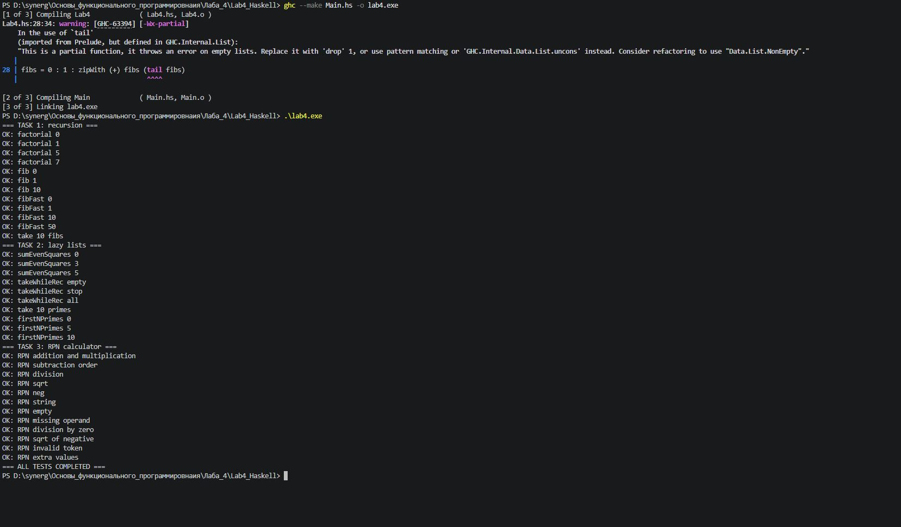
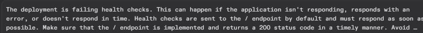
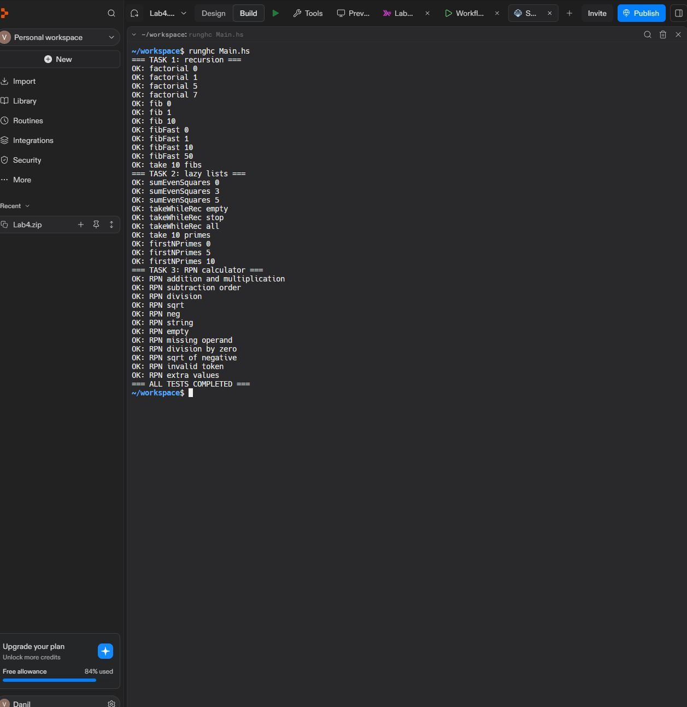

# Ошибки и предупреждения — лабораторная № 4

> Здесь собраны **реальные ситуации, возникшие при настройке проекта**, и команды, которыми удалось проверить и устранить проблему. В основной программе `Lab4.hs` исправлений не потребовалось.

[← На страницу лабораторной](README.md) · [Пошаговый запуск с нуля](GUIDE.md)

---

## 1. Команда `ghc` не распознаётся в Windows

**Что было в терминале:**

```text
PS> ghc --version
ghc : Имя "ghc" не распознано как имя командлета,
функции, файла сценария или выполняемой программы.
```

Проблема была связана с доступностью компилятора в переменной **PATH**, а не с Haskell-кодом.

### Проверка установки

В PowerShell:

```powershell
Test-Path "C:\ghcup\bin\ghcup.exe"
```

В данном случае команда вернула `True` — GHCup был найден.

Далее была выполнена команда:

```powershell
& "C:\ghcup\bin\ghcup.exe" list -t ghc
```

Вывод показал установленную версию **GHC 9.10.3**. Чтобы сделать её версией по умолчанию:

```powershell
& "C:\ghcup\bin\ghcup.exe" set ghc 9.10.3
```

Затем компилятор проверялся напрямую:

```powershell
& "C:\ghcup\bin\ghc.exe" --version
```

И временно добавлялся в PATH текущего PowerShell:

```powershell
$env:Path = "C:\ghcup\bin;$env:Path"
ghc --version
```

**Фактический результат:** `The Glorious Glasgow Haskell Compilation System, version 9.10.3`.

> [!NOTE]
> Папка установки или версия GHC могут отличаться. Команду `set ghc 9.10.3` используйте только если эта версия действительно установлена.

## 2. Предупреждение `-Wx-partial` при компиляции

Компиляция выполнялась командой:

```powershell
ghc --make Main.hs -o lab4.exe
```

Компилятор предупредил о вызове `tail` в выражении:

```haskell
fibs = 0 : 1 : zipWith (+) fibs (tail fibs)
```

Смысл предупреждения: `tail` не определена для **пустого** списка.

В данной лабораторной `fibs` начинается с двух элементов, `0` и `1`, поэтому именно этот вызов не получает пустой список. Предупреждение **не было ошибкой компиляции**: программа была собрана, а 34 проверки завершились успешно.

<details>
<summary><strong>Скриншот компиляции и предупреждения</strong></summary>



</details>

## 3. Проверка недопустимых аргументов в GHCi

После открытия модуля:

```powershell
ghci Lab4.hs
```

проверялись:

```haskell
factorial (-1)
fib (-1)
fibFast (-1)
```

Все три выражения выводили сообщения с `n must be >= 0`.

**Это ожидаемое поведение:** отрицательные аргументы для этих функций запрещены. Для выхода из GHCi используется `:quit`.

## 4. Replit: проект работает, но веб-публикация не запускается

При попытке публикации Replit сообщал о проверках работоспособности (**health checks**) и отсутствии корректного HTTP-ответа приложения.

<details>
<summary><strong>Скриншот сообщения о health checks</strong></summary>



</details>

**Причина:** этот проект — **консольная программа**, которая выполняет тесты и заканчивает работу. Это не веб-сервер и у него нет HTTP-страницы по адресу `/`.

Для выполнения лабораторной публикация веб-приложения не требуется.

**Правильный способ запуска в Replit:**

1. Откройте **Shell**.
2. Убедитесь, что `Lab4.hs` и `Main.hs` находятся в рабочей папке.
3. Выполните:

```bash
runghc Main.hs
```

В терминале появится:

```text
=== ALL TESTS COMPLETED ===
```

<details>
<summary><strong>Скриншот запуска тестов в Replit Shell</strong></summary>



</details>

Если публикация веб-приложения ранее была запущена, проверьте, что ненужное развёртывание остановлено, чтобы не тратить вычислительные ресурсы.

## 5. Краткая таблица диагностики

| Признак | Что делать |
|---|---|
| `ghc` не найден | Проверьте GHCup, установленную версию и PATH |
| Компилятор сообщает про `tail` | Это предупреждение, проверьте, есть ли ошибки компиляции и проходят ли тесты |
| `n must be >= 0` при отрицательном числе | Ошибка аргумента предусмотрена самой функцией |
| Replit показывает пустой Preview | Используйте **Shell**, потому что проект консольный |
| Replit не проходит HTTP health check | Не публикуйте консольную лабораторную как веб-приложение |
| Тесты выдают `FAIL` | Проверьте входные данные и строки `expected` / `actual` |

---

[К исходному коду](Lab4.hs) · [Гайд для начинающих](GUIDE.md) · [Ко всем лабораторным](../README.md)
