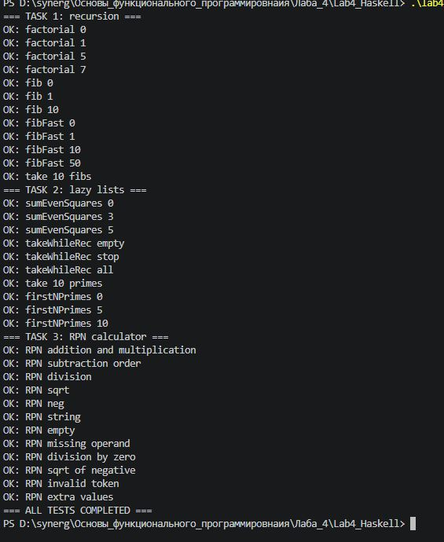
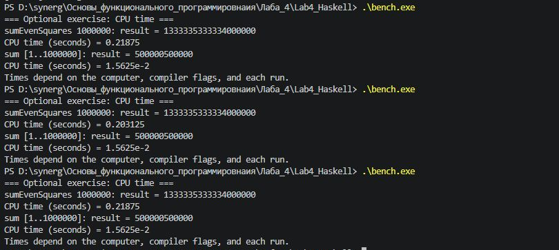

# Руководство для начинающих — лабораторная № 4

**Тема:** рекурсия и обработка списков · **Язык:** Haskell

[← На страницу лабораторной](README.md) · [Смотреть исходный код](Lab4.hs) · [Посмотреть тесты](Main.hs)

> Это пошаговое руководство поможет самостоятельно скачать, запустить и проверить лабораторную № 4, даже если вы раньше не работали с Haskell. В нём используются **реальные файлы этого проекта**.

## Содержание

1. [Что потребуется](#1-что-потребуется)
2. [Скачивание проекта](#2-скачивание-проекта)
3. [Установка Haskell на Windows](#3-установка-haskell-на-windows)
4. [Запуск всех тестов](#4-запуск-всех-тестов)
5. [Ручная проверка функций](#5-ручная-проверка-функций)
6. [Как устроены три задания](#6-как-устроены-три-задания)
7. [Измерение времени](#7-измерение-времени)
8. [Запуск через Replit](#8-запуск-через-replit)
9. [Частые ошибки](#9-частые-ошибки)
10. [Итоговый список проверки](#10-итоговый-список-проверки)

## 1. Что потребуется

- Windows и **Visual Studio Code** (подойдёт также любой текстовый редактор и терминал).
- Компилятор **GHC** и команды `ghc`, `ghci`, `runghc`.
- Файлы `Lab4.hs`, `Main.hs` и `Bench.hs`.

| Файл | Содержимое |
|---|---|
| [`Lab4.hs`](Lab4.hs) | Все функции лабораторной, обработка списков и RPN-калькулятор |
| [`Main.hs`](Main.hs) | 34 автоматических проверки |
| [`Bench.hs`](Bench.hs) | Дополнительные измерения процессорного времени |
| [`README.md`](README.md) | Краткое описание, результаты и скриншоты |

## 2. Скачивание проекта

1. Откройте [репозиторий](https://github.com/smadie228/synergy-functional-programming).
2. Нажмите **Code → Download ZIP**.
3. Распакуйте архив в удобную папку, например `Documents`.
4. Найдите внутри папку **`lab-04`**.
5. Откройте VS Code и выберите **File → Open Folder → lab-04**.

В левой панели должны отображаться файлы `Lab4.hs`, `Main.hs` и `Bench.hs`. Не пытайтесь запускать их прямо из ZIP-архива.

## 3. Установка Haskell на Windows

Самый удобный способ установить компилятор — **GHCup**.

1. Откройте официальный сайт: [haskell.org/ghcup/install](https://www.haskell.org/ghcup/install/).
2. Выберите инструкции для **Windows** и выполните указанную там команду установки.
3. В установщике установите **GHC**. Haskell Language Server (**HLS**) пригодится для работы в редакторе. **Stack** для этой лабораторной не обязателен.
4. Закройте VS Code и откройте заново.
5. Откройте **Terminal → New Terminal** и введите:

```powershell
ghc --version
```

Если появляется номер версии, компилятор доступен. Эта лабораторная уже запускалась с **GHC 9.10.3** в Windows и **GHC 8.10.6** в Replit.

<details>
<summary><strong>Команда ghc не найдена — что делать?</strong></summary>

Сначала проверьте наличие GHCup по часто используемому пути:

```powershell
Test-Path "C:\ghcup\bin\ghcup.exe"
```

Если результат `True`, посмотрите установленные версии:

```powershell
& "C:\ghcup\bin\ghcup.exe" list -t ghc
```

Если GHC установлен, но версия не выбрана по умолчанию, выполните `set`, указав **свою установленную версию**. Например:

```powershell
& "C:\ghcup\bin\ghcup.exe" set ghc 9.10.3
```

Если Windows всё ещё не видит `ghc`, временно добавьте путь **в текущем терминале PowerShell**:

```powershell
$env:Path = "C:\ghcup\bin;$env:Path"
ghc --version
```

Этот путь может отличаться на другом компьютере. Если `Test-Path` вернул `False`, проверьте путь установки по инструкции GHCup. Не нужно переустанавливать компилятор без проверки.

</details>

## 4. Запуск всех тестов

Убедитесь, что VS Code открыл **именно папку `lab-04`**. Затем в терминале введите:

```powershell
runghc Main.hs
```

Команда запускает тесты из `Main.hs`, который использует `Lab4.hs`. Результат должен начинаться примерно так:

```text
=== TASK 1: recursion ===
OK: factorial 0
OK: factorial 1
OK: factorial 5
...
```

Последняя строка успешного запуска:

```text
=== ALL TESTS COMPLETED ===
```

**Всего: 34 проверки.** Если вы видите `FAIL`, посмотрите строки `expected` и `actual` — они показывают, чего ожидал тест и что вернула функция.

Можно также скомпилировать программу в Windows:

```powershell
ghc --make Main.hs -o lab4.exe
.\lab4.exe
```

После компиляции появятся файлы `.o` и `.hi`. Это рабочие файлы GHC, загружать их на GitHub не требуется.



## 5. Ручная проверка функций

В терминале откройте интерактивную консоль Haskell:

```powershell
ghci Lab4.hs
```

Вводите следующие выражения по одному (без символов приглашения `ghci>`):

| Выражение | Ожидаемый результат |
|---|---|
| `factorial 5` | `120` |
| `fib 10` | `55` |
| `fibFast 10` | `55` |
| `take 10 fibs` | `[0,1,1,2,3,5,8,13,21,34]` |
| `sumEvenSquares 3` | `56` |
| `take 5 primes` | `[2,3,5,7,11]` |
| `takeWhileRec (< 5) [1,2,7,3]` | `[1,2]` |
| `evalRPNString "2 3 + 4 *"` | `Just 20.0` |

Для выхода из консоли:

```haskell
:quit
```

Для проверки неправильных аргументов откройте GHCi ещё раз и по одному выполните:

```haskell
factorial (-1)
fib (-1)
fibFast (-1)
```

Все три функции должны выдать ошибку с текстом `n must be >= 0`. Это **ожидаемая защита**, а не ошибка компиляции.

## 6. Как устроены три задания

### Задание 1. Рекурсия и числа Фибоначчи

**Рекурсия** — это вызов функции из неё самой. Важно предусмотреть базовый случай.

Например, вычисление `factorial 4`:

```text
factorial 4
= 4 * factorial 3
= 4 * 3 * factorial 2
= 4 * 3 * 2 * factorial 1
= 4 * 3 * 2 * 1 * factorial 0
= 24
```

- `factorial` — рекурсивный факториал.
- `fib` — обычная рекурсия с двумя вызовами для большинства положительных значений.
- `fibFast` — более быстрый вариант, который хранит два предыдущих числа.
- `fibs` — бесконечная последовательность, из которой можно взять первые `n` элементов командой `take n fibs`.

### Задание 2. Списки и ленивые вычисления

- `filter even` оставляет только чётные элементы.
- `map` применяет функцию к каждому элементу.
- `take n` берёт первые `n` элементов.
- `sum` складывает элементы.
- `takeWhileRec` забирает элементы только **до первого неподходящего**.
- `primes` генерирует простые числа, а `firstNPrimes` возвращает нужное количество.

Например, `sumEvenSquares 3` берёт числа 2, 4, 6 и считает сумму квадратов:

```text
2² + 4² + 6² = 4 + 16 + 36 = 56
```

С `takeWhileRec (< 5) [1,2,7,3]` получится `[1,2]`: на числе 7 отбор заканчивается, хотя после него есть 3.

### Задание 3. Калькулятор RPN

**Обратная польская запись** (RPN) — запись, где операция идёт **после** чисел.

Обычный вид: `(2 + 3) * 4`.  
RPN: `2 3 + 4 *`.

Калькулятор использует **стек**. Верх стека показан слева:

| Введено | Стек |
|---|---|
| `2` | `[2]` |
| `3` | `[3,2]` |
| `+` | `[5]` |
| `4` | `[4,5]` |
| `*` | `[20]` |

Попробуйте в GHCi:

```haskell
evalRPNString "10 3 -"
evalRPNString "6 2 /"
evalRPNString "9 sqrt"
evalRPNString "5 neg"
```

Ожидаемые результаты — `Just 7.0`, `Just 3.0`, `Just 3.0` и `Just (-5.0)`.

Две дополнительные операции в лабораторной — `sqrt` (квадратный корень) и `neg` (смена знака). Неверные выражения возвращают `Nothing`:

```haskell
evalRPNString "5 0 /"
evalRPNString "-9 sqrt"
evalRPNString "2 +"
```

Это защита от деления на ноль, квадратного корня из отрицательного числа и нехватки аргументов.

## 7. Измерение времени

Дополнительный файл запускается из терминала:

```powershell
runghc Bench.hs
```

Он измеряет процессорное время для:

- `sumEvenSquares 1000000`;
- `sum [1..1000000]`.

Числовые результаты должны быть одинаковыми при повторах, но **время зависит от компьютера, версии компилятора и способа запуска**. Измерение времени при `runghc` и после компиляции с оптимизациями может заметно различаться.

**Важно:** программы делают разную работу. По разнице времени этих двух выражений нельзя заключить, что ленивые вычисления сами по себе медленнее или быстрее.



## 8. Запуск через Replit

Replit можно использовать, если там уже создан проект Haskell с файлами из этой папки.

1. Откройте инструмент **Shell**.
2. Убедитесь, что `Lab4.hs` и `Main.hs` находятся в рабочей папке.
3. Запустите `runghc Main.hs`.
4. Убедитесь, что появилась строка `ALL TESTS COMPLETED`.

Это **консольная программа, а не веб-сайт**. Кнопка **Publish** для запуска лабораторной не требуется.

## 9. Частые ошибки

| Сообщение или ситуация | Решение |
|---|---|
| `ghc` не распознаётся | Проверьте установку GHC и путь PATH в Windows |
| `Could not find module 'Lab4'` | Откройте терминал в папке с `Lab4.hs` и `Main.hs` |
| `FAIL` в тестах | Проверьте сообщения `expected` и `actual`; сравните код с проектом |
| Калькулятор возвращает `Nothing` | Проверьте порядок чисел, операции и количество аргументов |
| Предупреждение про `tail` | `tail` небезопасен для пустого списка, но `fibs` начинается с 0 и 1 |
| Появились файлы `.o` / `.hi` | Это нормальные промежуточные файлы компилятора |
| Replit Preview не показывает сайт | Для лабораторной используйте **Shell**, а не веб-просмотр |

## 10. Итоговый список проверки

- [ ] Папка `lab-04` скачана и распакована.
- [ ] Команда `ghc --version` показывает версию GHC.
- [ ] Запуск `runghc Main.hs` завершается строкой `ALL TESTS COMPLETED`.
- [ ] Проверены факториал, два способа Фибоначчи и бесконечный список.
- [ ] Понятно, как работают `filter`, `map`, `take` и `takeWhileRec`.
- [ ] Понятен порядок операций в RPN-калькуляторе.
- [ ] `Bench.hs` запущен, а результаты времени интерпретированы корректно.

---

**Полезные ссылки:** [Установка GHCup](https://www.haskell.org/ghcup/install/) · [Haskell](https://www.haskell.org/) · [Главная страница лабораторной](README.md)

Если команда не работает, сначала перепроверьте текущую папку, имя файла и сообщение в терминале. Постепенно меняя входные значения и наблюдая результат, вы лучше поймёте работу каждого задания.
