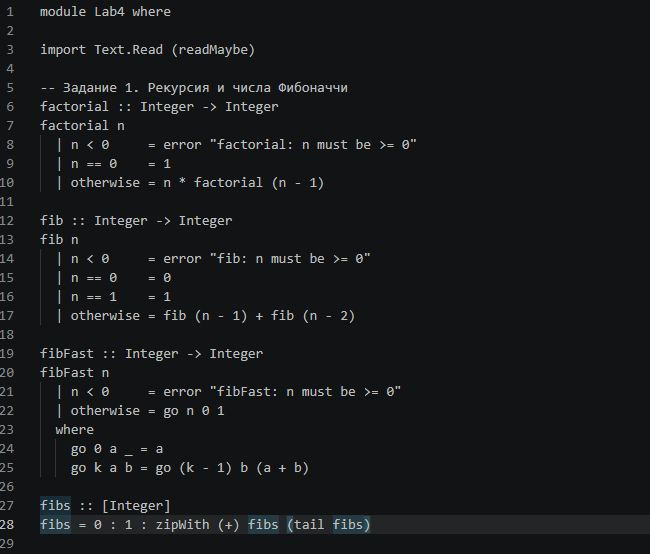
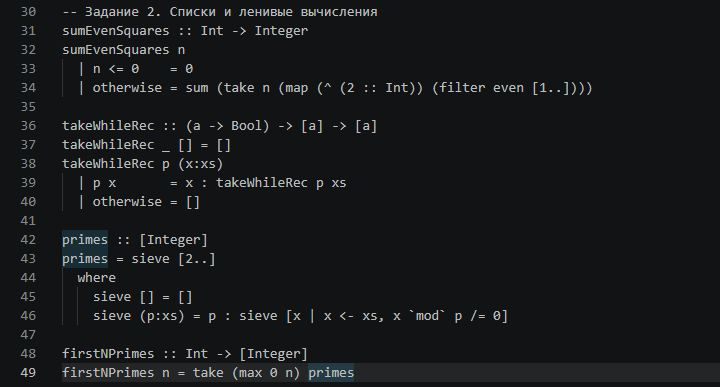
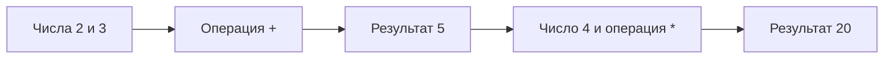
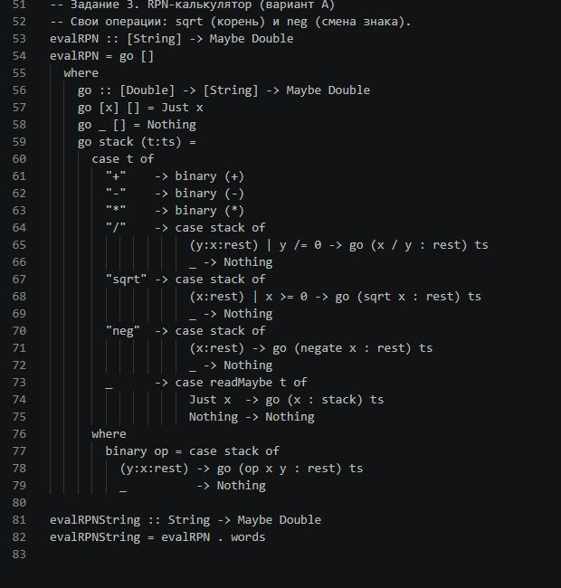
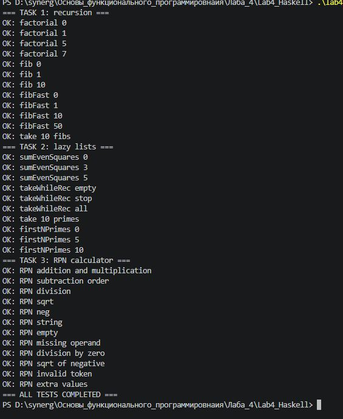
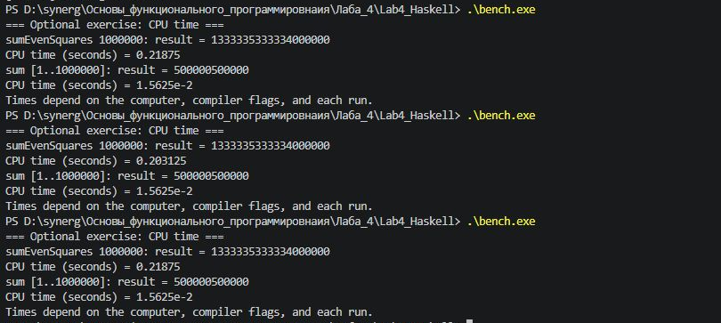

# Лабораторная работа № 4

**Рекурсия и обработка списков** · Haskell · Основы функционального программирования

**[📖 Пошаговый гайд для новичков](GUIDE.md)** · **[💻 Исходный код](Lab4.hs)** · **[🧪 Тесты](Main.hs)** · **[⏱ Замеры](Bench.hs)**

---

## Кратко о работе

| | |
|:---|:---|
| **Дисциплина** | Основы функционального программирования |
| **Тема** | Рекурсия и обработка списков |
| **Язык** | Haskell |
| **Среда** | Visual Studio Code, GHC, Replit |
| **Проверки** | **34 из 34** успешно пройдены |
| **Проверено в** | Windows — GHC 9.10.3; Replit — GHC 8.10.6 |

> [!TIP]
> **Впервые работаете с Haskell?** Начните с [подробного руководства](GUIDE.md). Там есть установка GHC, запуск программы и объяснение всех трёх заданий.

## Цель

Научиться писать рекурсивные функции, обрабатывать списки средствами Haskell, использовать ленивые вычисления и реализовать небольшой RPN-калькулятор.

## Выполненные задания

### 1. Рекурсивные алгоритмы

| Функция | Что делает |
|:---|:---|
| `factorial` | Вычисляет факториал |
| `fib` | Находит число Фибоначчи с помощью обычной рекурсии |
| `fibFast` | Вычисляет число Фибоначчи с накоплением промежуточных значений |
| `fibs` | Задаёт бесконечную последовательность Фибоначчи |

Для `factorial`, `fib` и `fibFast` предусмотрена проверка отрицательных аргументов.

<details>
<summary><strong>📷 Показать код задания 1</strong></summary>



</details>

### 2. Обработка списков и ленивые вычисления

| Функция | Что делает |
|:---|:---|
| `sumEvenSquares` | Считает сумму квадратов первых `n` чётных натуральных чисел |
| `takeWhileRec` | Рекурсивно берёт элементы до первого не подходящего под условие |
| `primes` | Создаёт бесконечный список простых чисел |
| `firstNPrimes` | Возвращает первые `n` простых чисел |

<details>
<summary><strong>📷 Показать код задания 2</strong></summary>



</details>

### 3. RPN-калькулятор (вариант А)

Калькулятор работает с **обратной польской записью**: операция записывается **после** чисел.

Например: обычная запись `(2 + 3) * 4` → RPN-запись `2 3 + 4 *`.



Поддерживаются операции `+`, `-`, `*`, `/`, а также две дополнительные: **`sqrt`** (квадратный корень) и **`neg`** (смена знака).

Корректное выражение возвращает `Just` с результатом. При некорректной записи, делении на ноль, нехватке операндов или корне из отрицательного числа возвращается `Nothing`.

<details>
<summary><strong>📷 Показать код задания 3</strong></summary>



</details>

## Файлы проекта

| Файл | Назначение |
|:---|:---|
| [`Lab4.hs`](Lab4.hs) | Исходный код всех трёх заданий |
| [`Main.hs`](Main.hs) | 34 автоматические проверки |
| [`Bench.hs`](Bench.hs) | Дополнительные измерения процессорного времени |
| [`GUIDE.md`](GUIDE.md) | Подробное руководство по установке, запуску и изучению кода |
| [`images/`](images/) | Реальные скриншоты кода и результатов |

## Как запустить

Нужен компилятор **GHC**. Откройте терминал в папке `lab-04` и запустите:

```bash
runghc Main.hs
```

Альтернативный способ для Windows:

```powershell
ghc --make Main.hs -o lab4.exe
.\lab4.exe
```

Если проверки пройдены, в конце будет:

```text
=== ALL TESTS COMPLETED ===
```

<details open>
<summary><strong>📷 Результат запуска: 34 успешных теста</strong></summary>



</details>

## Дополнительное задание — время вычислений

Запуск:

```bash
runghc Bench.hs
```

Программа измеряет процессорное время для `sumEvenSquares 1000000` и `sum [1..1000000]`.

Время может различаться при повторных запусках. Сравнение **не является** строгой проверкой того, быстрее или медленнее ленивые вычисления: функции делают разную работу.

<details>
<summary><strong>📷 Показать реальные результаты измерений</strong></summary>



</details>

## Вывод

В этой работе я реализовал рекурсивные функции, обработку списков и калькулятор с обратной польской записью. Проверил обычные и ошибочные случаи, запустил 34 автоматических теста в Windows и Replit, а также выполнил дополнительные измерения времени.

---

[↑ К началу](#лабораторная-работа--4) · [Руководство для начинающих](GUIDE.md) · [Ко всем лабораторным](../README.md)
